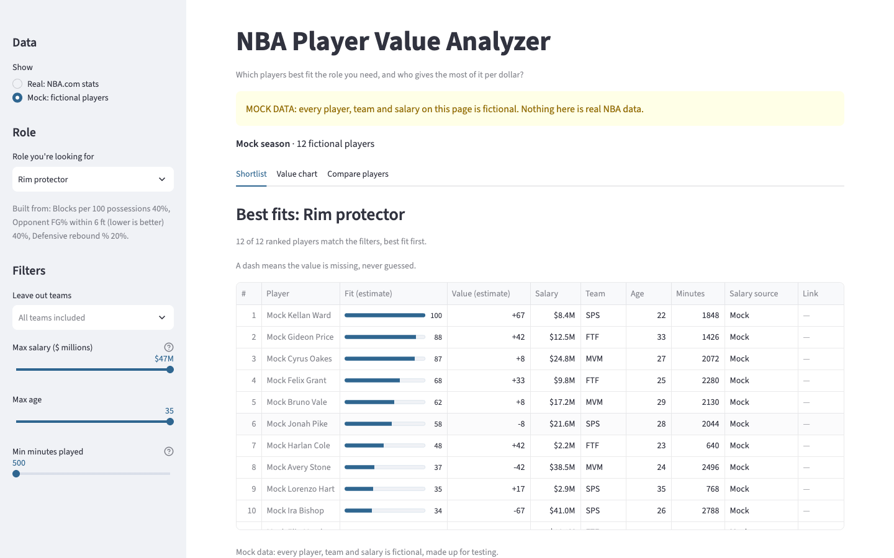
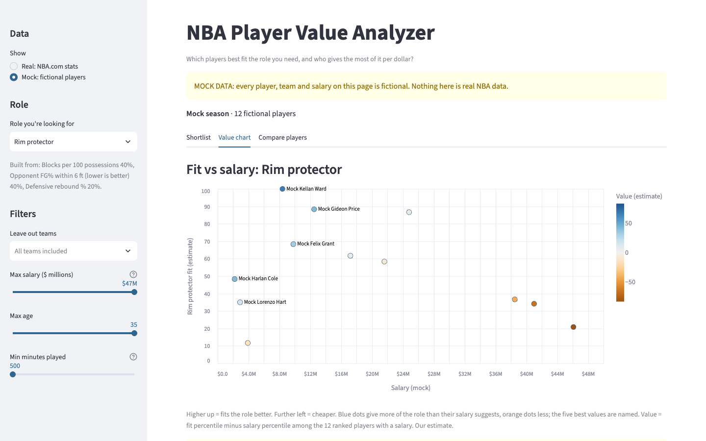
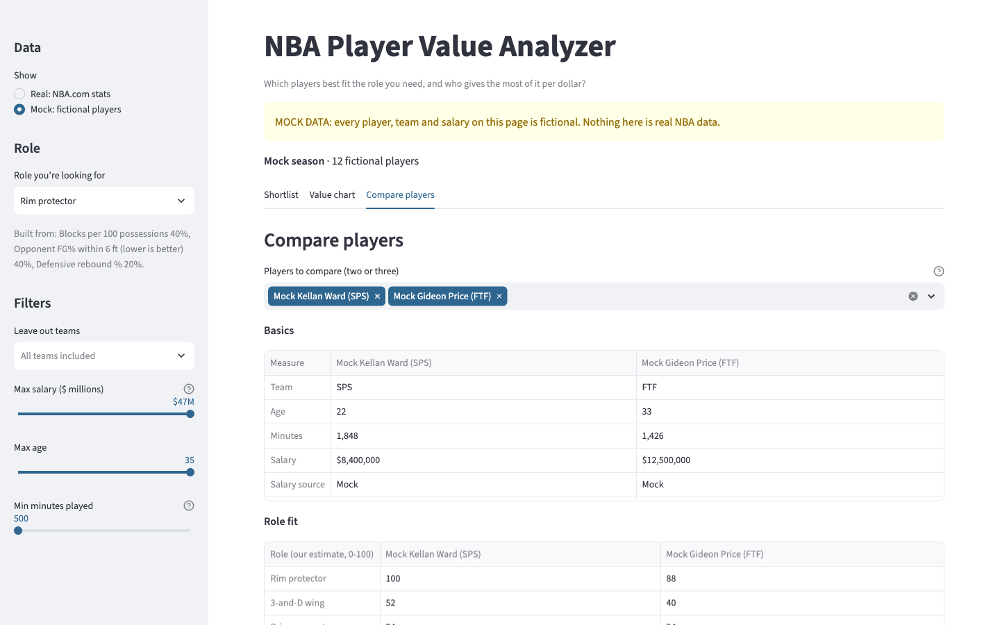

# NBA Player Value Analyzer

A local app that answers one question: *which NBA players best fit the role I'm looking for, and who gives the most of that role per dollar of salary?*

Pick a role such as rim protector or 3-and-D wing. The app ranks every player with 500+ minutes by how well their 2025-26 NBA.com stats fit that role, plots fit against salary to show who is cheap or expensive for what they do, and puts two or three players side by side.

> **Status: MVP complete (6 of 6 steps).** A personal, non-commercial fan and learning project. Fit and value scores are our own estimates, not facts. Ideas for after the MVP (team needs, trades, contract length) are listed in [docs/mvp-plan.md](docs/mvp-plan.md#ideas-for-later).



*All screenshots use the fictional mock dataset: real NBA.com data may not be republished.*

## What it does

- **Six role fit scores (0–100):** rim protector, 3-and-D wing, primary creator, shot creator, interior big and connector. Each is a weighted mix of stat percentiles, set in [`config/roles.toml`](config/roles.toml).
- **Shortlist:** players ranked by fit, filtered by team, salary, age and minutes.
- **Value chart:** fit against reported salary. Value = fit percentile minus salary percentile, so a high-fit, low-salary player scores high.
- **Comparison:** two or three players side by side, with the stats behind each score.

| Value chart | Compare players |
| --- | --- |
|  |  |

**How the numbers are made, and their limits:** [docs/method.md](docs/method.md). The plan is in [docs/mvp-plan.md](docs/mvp-plan.md) and the data flow in [docs/architecture.md](docs/architecture.md).

## Data and labels

Every value the app shows carries a label:

| Label | Meaning |
| --- | --- |
| `NBA.com` | Official 2025-26 stats from NBA.com, with the date fetched |
| `Reported salary` | A salary from a named public source, with its link and date |
| `Estimate` | Something this app calculates: fit and value scores |
| `Mock` | Fictional data for testing and demos. See [data/mock/README.md](data/mock/README.md) |

Stats are from **[NBA.com](https://www.nba.com/stats)**, fetched with the unofficial [`nba_api`](https://github.com/swar/nba_api) package. This project isn't affiliated with or endorsed by the NBA. NBA.com's [terms](https://www.nba.com/terms) allow personal, non-commercial use with attribution, but not republishing, so real data is downloaded to your own machine and **never committed** (`data/raw/`, `data/processed/` and `data/salaries/` are git-ignored). The app credits NBA.com on every screen with real stats. Missing values are shown as missing, never guessed.

## Setup

You need [uv](https://docs.astral.sh/uv/), which downloads the right Python (3.13) for you. The project needs Python 3.11 or newer; an older system `python3` won't work.

```bash
# 1. Get the code
git clone https://github.com/nathanZKL/NBA-Player-Value-Analyzer.git
cd NBA-Player-Value-Analyzer

# 2. Create a virtual environment: a private folder of packages just for this project
uv venv --python 3.13 .venv

# 3. Turn it on (do this every time you open a new terminal)
source .venv/bin/activate        # macOS / Linux
# .venv\Scripts\activate         # Windows

# 4. Install the packages
uv pip install -r requirements-dev.txt
```

## Run the app

```bash
streamlit run app.py
```

Your browser opens at http://localhost:8501. Press `Ctrl+C` in the terminal to stop it.

- **Sidebar:** choose real or mock data, the role you're looking for, and filters (teams to leave out, max salary, max age, min minutes).
- **Shortlist:** players ranked by fit for that role, with value score, salary and where the salary came from. A dash means missing, never guessed.
- **Value chart:** fit against salary. Blue dots give more of the role than their salary suggests, orange dots less. Hover a dot for details.
- **Compare players:** two or three players side by side: role scores and the stats behind them.

Before you fetch real data (next section) the app shows fictional players with a yellow **MOCK DATA** warning. Fit and value scores are our own estimates, not facts. Only players with 500+ minutes are ranked.

## Fetch real NBA.com stats (optional, your own machine only)

```bash
python -m nbavalue.update_data
```

This downloads 2025-26 player stats from NBA.com into `data/raw/2025-26/<date>/` (nine requests, a few seconds apart: box score, advanced, hustle, rim defence, pull-ups and four play types) and builds `data/processed/players.csv`. Running it again reuses the saved files; add `--refresh` to download again. Both folders are git-ignored: NBA.com's terms allow personal use but not republishing. Restart the app afterwards (or reload the page) and it uses this file.

## Import salaries (optional, your own machine only)

Salaries come from a CSV you make yourself, with a source on every row. Fetch the NBA.com stats first, then:

1. Create `data/salaries/salaries_2025-26.csv` with these columns (the folder is git-ignored):

   ```csv
   player_name,team,season,salary_usd,source,source_url,retrieved_on,data_label
   Example Player,BOS,2025-26,12500000,Site name,https://example.com/page,2026-10-24,Reported salary
   ```

   `salary_usd` is whole dollars, digits only: the import refuses `$`, commas and Excel's `1.25E+07` form, which loses digits. `retrieved_on` is the date you read it (YYYY-MM-DD). Every row needs a source and link.
2. Run:

   ```bash
   python -m nbavalue.import_salaries
   ```

   It matches each row to an NBA.com player by name (accents, capitals, punctuation and Jr./III are ignored; the team only decides between players with the same name). It writes `data/processed/salaries.csv` and lists rows it couldn't match, with suggestions, in `data/processed/salary_unmatched.csv`.
3. For a row that didn't match (often a nickname), add it to `data/salaries/overrides.csv` with the player's NBA.com ID from the suggestions, and run the command again:

   ```csv
   player_name,team,player_id,note
   Nic Example,BKN,1234567,listed as Nicolas on NBA.com
   ```

   Write the name and team exactly as in your salary file. An override that fits no salary row stops the import, so a typo can't be silently ignored.

   NBA.com's stats only list players who played at least one 2025-26 game. A player who missed the whole season (for example through injury) will always show as unmatched: leave him unmatched and don't add an override, because the suggestions are different players.

Players without a salary are shown as missing, never guessed.

## Check the code

```bash
pytest              # run the tests
ruff check .        # look for common mistakes
ruff format .       # tidy the formatting
```

## Project layout

```
app.py               Streamlit app (the screen you see)
nbavalue/            Python code the app uses
  labels.py          The data labels above
  mock_data.py       Loads and checks the mock data
  fetch.py           Downloads NBA.com stats politely, with a cache
  prepare.py         Checks and labels them as one row per player
  update_data.py     The command that runs fetch + prepare
  salaries.py        Checks the salary CSV and matches it to players
  import_salaries.py The command that imports salaries
  analysis.py        Per-100 stats and league percentiles
  roles.py           Role fit scores and value scores (our estimates)
  board.py           Joins everything into the tables the app shows
config/roles.toml    The six roles: which stats count, and how much
data/mock/           Fictional data, committed to the repo
tests/               Automated checks
docs/                Method, plan, architecture, decisions, handoff
docs/images/         README screenshots (mock data only)
CLAUDE.md            Instructions for Claude when working on this repo
```

No configuration or API keys are needed. NBA.com stats don't need a key, so there is no `.env` file yet.

## License

MIT. See [LICENSE](LICENSE).
