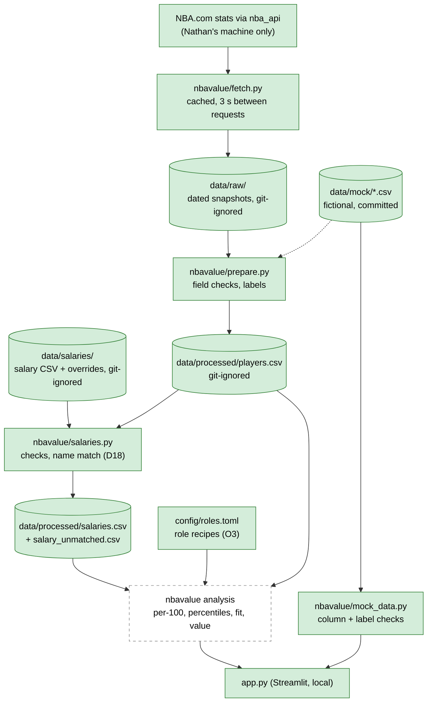

# Architecture

How data moves through the MVP. Data flows one way, from the sources down to the app, and each step hands the next a plain CSV file. Decisions referenced as D# / O# are in [decisions.md](decisions.md).

## What exists today (step 3 merged)

The app still reads only the committed mock CSVs. The NBA.com fetch and prepare code works: Nathan's first real fetch (2026-10-24) produced 582 players. The salary import checks a hand-made salary CSV and matches it to those players. The app doesn't read either output yet. Mock players already use the same columns as the real table (D17).

| Piece | File | Status |
| --- | --- | --- |
| Data labels | `nbavalue/labels.py` | ✅ Built |
| Shared column check | `nbavalue/checks.py` | ✅ Built (`require_columns`) |
| Mock data loader + validation | `nbavalue/mock_data.py` | ✅ Built (raises `ValueError` on missing columns or non-`Mock` rows) |
| NBA.com fetch | `nbavalue/fetch.py` | ✅ Built: 9 tables (base, advanced, hustle, rim defence, pull-ups, 4 play types), 3 s pause, snapshot reuse. All 9 run for real on 2026-10-26 (D28) |
| Prepare (field checks, mapping, labels) | `nbavalue/prepare.py` | ✅ Built: writes `data/processed/players.csv` with `NBA.com` label and `fetched_on` date. Extra tables keep counting stats only, add up a traded player's rows, and leave players they omit as missing |
| Per-100 stats and percentiles | `nbavalue/analysis.py` | ✅ Built (step 4a): per-100 stats and ratios from season totals; 0–100 league percentiles among players with 500+ minutes (D25); opponent rim FG% flipped; missing stays missing, except play-type volume blanks (fewer than 10 possessions) rank tied for last (D29); efficiency needs 25 plays / 50 pull-ups (D30) |
| Command | `nbavalue/update_data.py` | ✅ Built: `python -m nbavalue.update_data [--refresh]` |
| Salary check and match | `nbavalue/salaries.py` | ✅ Built: validates the salary CSV, matches by normalised name with team as tie-break and an override file (D18–D21); digits-only salaries and no unused overrides (D23); players with no 2025-26 games stay unmatched (D22) |
| Salary command | `nbavalue/import_salaries.py` | ✅ Built: `python -m nbavalue.import_salaries` writes `data/processed/salaries.csv` and `salary_unmatched.csv`. Not yet run on real salaries |
| Role recipes | `config/roles.toml` | ✅ Built (step 4b): six starter roles, each a list of stats with weights; Claude's starting guesses (D27), read with Python's built-in `tomllib` (no new dependency) |
| Fit and value scores | `nbavalue/roles.py` | ✅ Built (step 4b): `load_roles` checks the config loudly; `fit_scores` = weighted average of a player's stat percentiles per role (a stat with no percentile is left out and the other weights count for more, D29); `value_scores` = fit percentile minus salary percentile among players with both (D10). Both labelled `Estimate`. Takes the percentile table from step 4a; not yet wired into the app |
| Mock dataset | `data/mock/players.csv`, `data/mock/salaries.csv` | ✅ Built; players use the real table's columns (D17) |
| Streamlit app | `app.py` | ✅ Skeleton only: mock warning and two tables |
| Tests | `tests/` | ✅ 104 tests, including a headless app smoke test; fetch tests use `tests/fake_nba.py`, never the network |
| Everything else in the diagram | — | Planned |

## Technology stack

| Tool | Version | Role |
| --- | --- | --- |
| Python | 3.11+ required, verified on 3.13 | Language |
| pandas | `>=2.2,<3` (verified 2.3.3) | Tables |
| Streamlit | `>=1.40,<2` (verified 1.66.1) | Local web UI |
| pytest, ruff | `pytest>=8,<9`, `ruff>=0.6` | Tests, lint and formatting (dev only) |
| `nba_api` | `>=1.12,<2` (verified 1.12.0) | NBA.com fetch |

## Data sources

| Source | Status | Label | Notes |
| --- | --- | --- | --- |
| Mock data (`data/mock/`) | ✅ In use | `Mock` | Fictional, committed. Tests, demos, public screenshots. |
| NBA.com stats via `nba_api`, 2025-26 | ✅ Base + advanced fetched on Nathan's machine (step 2) | `NBA.com` + fetch date | Personal, non-commercial use, with attribution. Never committed. Fetch runs on Nathan's machine only. |
| Salary CSV (`data/salaries/`, git-ignored) | ✅ Import built (step 3); Nathan builds the file by hand | `Reported salary` + source, URL, date | An optional scraper could fill it later (site still open, O1). |
| Basketball-Reference | ❌ Not used | — | Terms forbid it (D4). |

## Data flow

Solid green boxes exist; dashed boxes are planned. Real data lives only on Nathan's machine.

Today the app reads mock data directly through `mock_data.py`. Because mock players share the real table's columns (D17), the step 4 analysis functions take either table unchanged.

## Planned components

| Component | What it does | Step |
| --- | --- | --- |
| `scrape_salaries` | Optional. Writes the same CSV format, only after the site's terms and robots.txt are checked (O1). | Later |
| `data/processed/players.csv` | One row per player, rebuilt from raw files. Git-ignored. | 2–3 |
| Analysis library | Pure functions: per-100 stats, league percentiles with a minimum-minutes cut (step 4a). Role fit and value score are built in `nbavalue/roles.py` (step 4b). Most heavily tested part. | 4 |
| App screens | Shortlist, value chart, comparison, method page. Credits NBA.com on every screen with real stats. | 5–6 |

## Deliberately left out

A database, a backend API, cloud hosting, scheduled refreshes, Docker, user accounts and any extra caching layer (D2, D11).
