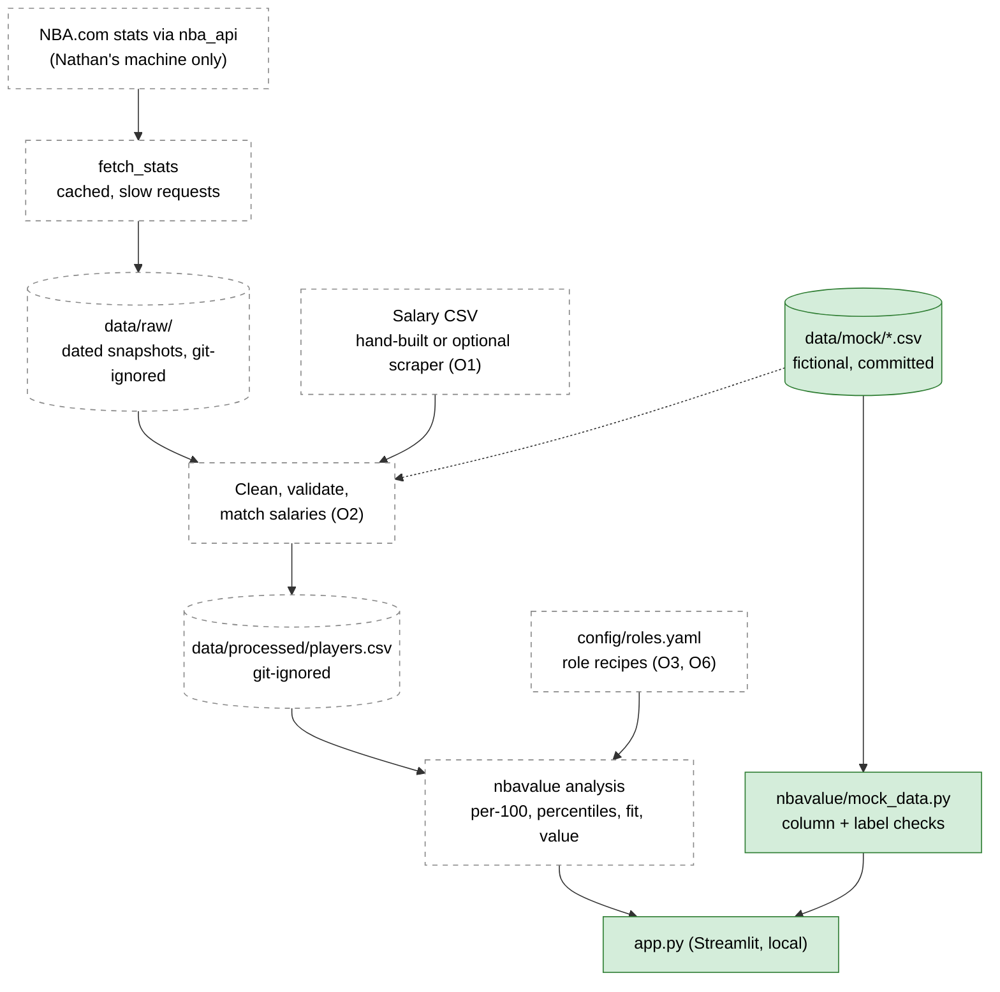

# Architecture

How data moves through the MVP. Data flows one way, from the sources down to the app, and each step hands the next a plain CSV file. Decisions referenced as D# / O# are in [decisions.md](decisions.md).

## What exists today (after step 1)

Only the mock path is built. The app reads the committed mock CSVs, checks columns and labels, and shows two tables under a mock-data warning.

| Piece | File | Status |
| --- | --- | --- |
| Data labels | `nbavalue/labels.py` | ✅ Built |
| Mock data loader + validation | `nbavalue/mock_data.py` | ✅ Built (raises `ValueError` on missing columns or non-`Mock` rows) |
| Mock dataset | `data/mock/players.csv`, `data/mock/salaries.csv` | ✅ Built (columns are a first draft) |
| Streamlit app | `app.py` | ✅ Skeleton only: mock warning and two tables |
| Tests | `tests/test_mock_data.py`, `tests/test_app.py` | ✅ 7 tests, including a headless app smoke test |
| Everything else in the diagram | — | Planned |

## Technology stack

| Tool | Version | Role |
| --- | --- | --- |
| Python | 3.11+ required, verified on 3.13 | Language |
| pandas | `>=2.2,<3` (verified 2.3.3) | Tables |
| Streamlit | `>=1.40,<2` (verified 1.66.1) | Local web UI |
| pytest, ruff | `pytest>=8,<9`, `ruff>=0.6` | Tests, lint and formatting (dev only) |
| `nba_api` | Planned for step 2, not yet a dependency | NBA.com fetch |

## Data sources

| Source | Status | Label | Notes |
| --- | --- | --- | --- |
| Mock data (`data/mock/`) | ✅ In use | `Mock` | Fictional, committed. Tests, demos, public screenshots. |
| NBA.com stats via `nba_api`, 2025-26 | Planned (step 2) | `NBA.com` + fetch date | Personal, non-commercial use, with attribution. Never committed. Fetch runs on Nathan's machine only. |
| Salary CSV | Planned (step 3) | `Reported salary` + source, URL, date | Hand-built or from an optional scraper (site still open, O1). |
| Basketball-Reference | ❌ Not used | — | Terms forbid it (D4). |

## Data flow

Solid green boxes exist; dashed boxes are planned.

Today the app reads mock data directly through `mock_data.py`. Once steps 2 to 4 land, mock data is meant to go through the same prepare and analysis path as real data. Exactly how is decided in step 2.

## Planned components

| Component | What it does | Step |
| --- | --- | --- |
| `fetch_stats` | Downloads 2025-26 stats through `nba_api` into dated files in `data/raw/`. Pauses between requests and reuses its cache. | 2 |
| Clean + validate | Checks every expected field exists, stops with a clear error if one is missing, attaches source labels. | 2 |
| Salary import / match | Reads the salary CSV, joins each row to an NBA.com player ID. Unmatched rows are listed for a human, never silently dropped. | 3 |
| `scrape_salaries` | Optional. Writes the same CSV format, only after the site's terms and robots.txt are checked. | 3 |
| `data/processed/players.csv` | One row per player, rebuilt from raw files. Git-ignored. | 2–3 |
| `config/roles.yaml` | Six role recipes (stats and weights), editable without code changes. | 4 |
| Analysis library | Pure functions: per-100 stats, league percentiles with a minimum-minutes cut, role fit (0–100), value score. Most heavily tested part. | 4 |
| App screens | Shortlist, value chart, comparison, method page. Credits NBA.com on every screen with real stats. | 5–6 |

## Deliberately left out

A database, a backend API, cloud hosting, scheduled refreshes, Docker, user accounts and any extra caching layer (D2, D11).
