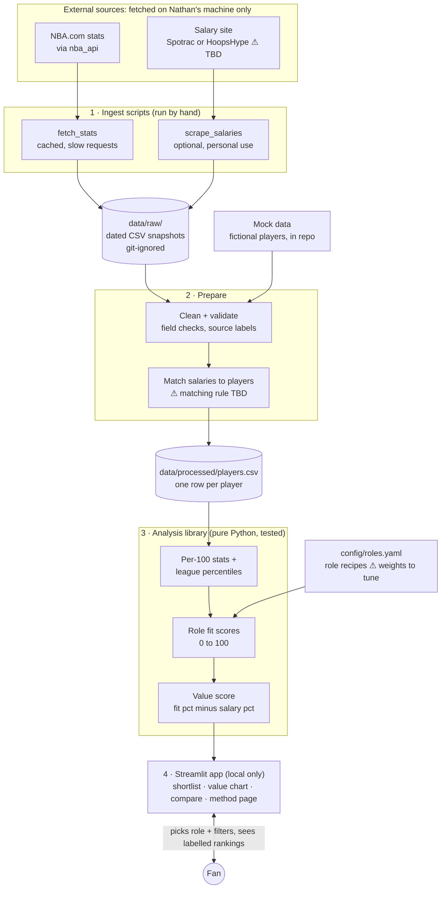

# Architecture

How data moves through the MVP. Data flows one way, from the sources down to the app, and each step hands the next a plain CSV file. Items marked ⚠ are unresolved decisions (see [mvp-plan.md](mvp-plan.md#open-decisions)).

## Components

| Component | What it does | Built in step |
| --- | --- | --- |
| `fetch_stats` | Downloads 2025-26 player stats from NBA.com through `nba_api`. Saves dated raw files, pauses between requests, and reuses its cache instead of downloading again. | 2 |
| `scrape_salaries` | Optional. Reads one salary site and writes the salary CSV format (the same format a hand-built file uses), with a source and date on every row. Only used once the site's terms and robots.txt have been checked. | 3 |
| `data/raw/` | Dated snapshots of everything downloaded. Git-ignored, so NBA.com and salary data never reach the public repo. | 2 |
| Mock data (`data/mock/`) | Fictional players and salaries committed to the repo. Powers tests, offline demos and public screenshots. | 1 |
| Clean + validate | Checks every expected field exists and stops with a clear error if one is missing. Standardises columns and attaches a source label to every value. | 2 |
| Match salaries | Joins each salary row to an NBA.com player ID. Unmatched rows are listed for a human to fix, never silently dropped. | 3 |
| `data/processed/players.csv` | One row per player, rebuilt from raw files whenever the prepare step runs. Git-ignored. | 2–3 |
| `config/roles.yaml` | The six role recipes (stats and weights). Editable without touching code. | 4 |
| Analysis library | Pure functions, no UI code: per-100-possession stats, league percentiles with a minimum-minutes cut, role fit (0–100), value score. The most heavily tested part. | 4 |
| Streamlit app (`app.py`) | Reads the player table, calls the analysis library, shows the shortlist, value chart, comparison and method page. Credits NBA.com on every screen. | 1 (mock only), 5 |

## Deliberately left out

A database, a backend API, cloud hosting, scheduled refreshes, Docker, user accounts and any extra caching layer. About 500 players fit comfortably in CSV files and pandas. Hosting is also ruled out by NBA.com's terms (see the plan).
